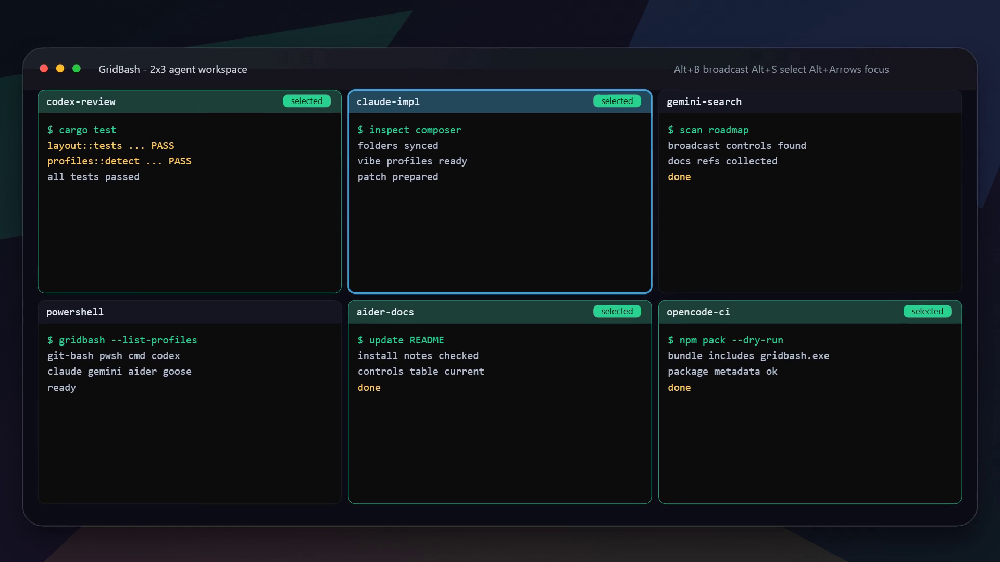

# GridBash

[](https://github.com/jasonsuhari/gridbash/actions/workflows/ci.yml)
[](https://www.npmjs.com/package/gridbash)
[](LICENSE)
[](https://github.com/jasonsuhari/gridbash)

**The sexiest way to tokenmaxx.**

GridBash is a local workspace for running and coordinating CLI coding agents in
parallel. Launch, authenticate, isolate, monitor, and steer Codex, Claude, and
other agents side by side, each in a real PTY pane.

[Website](https://jasonsuhari.github.io/gridbash/) |
[npm](https://www.npmjs.com/package/gridbash) |
[Releases](https://github.com/jasonsuhari/gridbash/releases) |
[Full reference](docs/REFERENCE.md)

[](https://github.com/jasonsuhari/gridbash/blob/main/docs/assets/gridbash-openvid-demo.mp4)

## Quick start

Requires Node.js 18+. GridBash releases Windows x64, glibc-based Linux
x64/arm64, and macOS 13+ binaries for Apple Silicon and Intel.

```sh
npm install -g gridbash
gridbash
```

Or launch a six-pane Codex grid directly:

```sh
gridbash 2x3 --profile codex
```

The npm package installs only the native binary for your current platform.
The npm badge shows the version currently available from the registry. If it
temporarily trails the [latest GitHub release](https://github.com/jasonsuhari/gridbash/releases/latest),
use that release's matching native artifact until npm publication catches up.

## Why GridBash

- **Precise input routing.** Type into the focused pane, a selected set, or the
  entire grid.
- **Named grids you can bring back.** Name a grid once and GridBash remembers
  its shape and folder; type the name again and all three come back. Worktrees
  and the shell profile are assumed for you.
- **Real terminals underneath.** Run up to 100 PTY-backed panes across tabbed
  grids, with raw shell grids still available as a secondary path.
- **Safer parallel work.** Give every pane an isolated repo-local git worktree.
- **Agent-first profiles.** Launch Codex, Claude, Gemini, Aider, OpenCode, Goose,
  Amp, Cursor, Copilot, shells, or custom commands.
- **Built-in workflow tools.** Resize grids, restore sessions, dictate prompts,
  inspect stable pane activity, optionally generate concise AI work summaries,
  use the per-grid BashBot Director to brief panes, route targeted follow-ups,
  or continuously supervise an explicit goal.
- **Optional background terminals.** Close the UI without stopping live panes,
  then reconnect to the same processes from a saved session.

## Common commands

| Command | Result |
| --- | --- |
| `gridbash` | Create a managed agent workspace interactively |
| `gridbash 2x3 --profile codex` | Launch a 2-by-3 Codex grid |
| `gridbash --count 12 --layout auto --profile claude` | Auto-arrange 12 Claude panes |
| `gridbash 2x3 --profile codex --worktrees` | Isolate every pane in a git worktree |
| `gridbash resume` | Choose a saved session to reopen |
| `gridbash resume --latest` | Reopen the latest saved session |
| `gridbash resume <id> --delete` | Permanently delete a saved session |
| `gridbash agent panes` | List sibling panes from inside a GridBash pane |
| `gridbash agent prompt --others "Report status"` | Prompt every other available pane |
| `gridbash agent rename "Reviewer"` | Retitle a pane so the grid shows its role |
| `gridbash ctl list --json` | Discover running grids |
| `gridbash ctl panes --session ID` | Inspect numbered and stable pane identities |
| `gridbash --list-profiles` | Show detected profiles and resolved commands |
| `gridbash doctor` | Check that this terminal can deliver the Alt shortcuts |
| `gridbash --help` | Show every CLI option |

`--worktrees` requires a git repository with at least one commit and no tracked
modifications. See the [reference](docs/REFERENCE.md#managed-git-worktrees) for
its folder, branch, and reuse behavior.

## Essential controls

GridBash shortcuts are modeless, so normal terminal keys continue to reach your
agents and shells.

On macOS, Option is spent on character composition by default, so `Option+C`
types `ç` and no Alt chord reaches GridBash. Run `gridbash doctor` to turn
Option into Alt, or press the `Ctrl+G` leader and then the shortcut key on its
own — `Ctrl+G` `N` for a new tab. GridBash labels its shortcuts with whichever
of the two your terminal can actually deliver.

| Input | Action |
| --- | --- |
| Drag mouse | Select and copy text inside one pane |
| Right-click pane | Add or remove the pane from the selected set |
| Left-click grid tab | Switch directly to that grid |
| Right-click grid tab | Add or remove the grid from the selected set |
| `Alt+n` | Open a new tab |
| `Alt+r` / `Alt+Shift+r` | Rename the focused pane / the current tab |
| `Alt+s` / `Alt+a` | Toggle the focused pane / select or clear all panes |
| `Alt+x` | Swap the selected panes or grids |
| `Alt+l` | Resize the grid |
| `Alt+w` | Close the current grid after confirmation |
| `Alt+p` | Park the focused pane, with an optional "tell me when" in your words; on the Parked tab, send it back |
| `Alt+j` | Focus the next pane that needs you, in any grid |
| `Alt+g` | On the Parked tab, give the selected pane a new goal |
| `Alt+k` | Move the focused Claude pane to another account, keeping its conversation |
| `F1` | Open the in-app shortcut guide |
| `Alt+q` | Show the quit confirmation and exact resume command |

Every other action (zoom, settings, the command palette, focus by arrow, ports, background agents and the rest) has no default key. Bind any of them under `[keys]` in the config, using the action names in `docs/REFERENCE.md`.

On macOS, Option is a character composer rather than Alt in Apple Terminal,
iTerm2, and Ghostty, so GridBash adds a leader key: press `Ctrl+G`, release it,
then press the shortcut key without Alt — `Ctrl+G` then `c` for the command
center, `Ctrl+G` then an arrow to move focus. Turning on the terminal's Option
as Meta setting makes the Alt shortcuts work directly instead.

See the [full controls reference](docs/REFERENCE.md#controls) for resizing,
renaming, sleeping, restarting, scrolling, settings, and recovery actions.

To keep live terminals running after GridBash closes, open Settings and
enable **Keep terminals running**. GridBash returns control to the
launching shell when you quit; reconnect later with `gridbash resume --latest`
or select the session with `gridbash resume`.

Running Codex panes are also saved by conversation ID. If their live terminal
cannot survive a restart or laptop shutdown, `gridbash resume` relaunches them
with `codex resume <conversation-id>` instead of opening an empty terminal.
This also covers Codex started manually inside a GridBash Git Bash pane.

`Alt+q` snapshots the current workspace and opens a confirmation with the full
`gridbash resume <session-id>` command for that exact setup. Press `Alt+q` again
to close GridBash, or any other key to cancel. The same command is printed after
GridBash returns to the launching shell. Quit confirmation is enabled by default
and can be disabled in Settings.

A plain `gridbash` always gives you a new, empty workspace. If the terminal or
GridBash process closes unexpectedly, run `gridbash --recover` to reopen the
unfinished agent sessions it left behind — each interrupted workspace comes back
with its grids intact, and `Alt+t` moves between tabs. A plain launch says in the
tab strip note when there is something to recover, and older snapshots remain
available through `gridbash resume`.

## Profiles and configuration

A bare `gridbash`, or `Alt+n` in a running workspace, opens the new-grid screen:
a centred dialog that asks for a grid name, a size, and a project folder, one
step at a time. Naming a grid records its size and folder, so typing that name
again recalls both — press `↑↓` on the first step to pick from the grids you
have launched before. Managed worktrees are on whenever the repository can
host them, and panes start in the platform shell (Git Bash on Windows). Choose
agents per pane afterwards, or launch them straight from the CLI with
`--profile`.

Managed auth applies to Claude or Codex processes GridBash launches. GridBash
does not install global shims, replace the normal `codex` or `claude` commands,
or intercept commands typed in an unmanaged shell.

Agent profiles are available on every platform: `codex`, `claude`, `gemini`,
`opencode`, `aider`, `amp`, `goose`, `copilot`, and `cursor`.
Profiles invoke CLIs already installed on your system; GridBash does not bundle
the agents themselves.

Terminal profiles are platform-specific:

```text
Windows:      git-bash pwsh powershell cmd
macOS/Linux:  zsh bash fish sh pwsh
```

Run `gridbash --list-profiles` to see what is available on your machine. Direct
launches resolve profiles in this order: `--profile`, `GRIDBASH_PROFILE`, the
invoking Windows shell, the configured default, then the platform default.

Start from [`config.example.toml`](config.example.toml) to define custom
profiles, UI settings, auth defaults, manager credentials, and workload policy.
The [configuration reference](docs/REFERENCE.md#configuration) covers file
locations and precedence.

Application shortcuts can also be remapped in `[keys]`, for example
`zoom-pane = "ctrl+shift+k"`. Unlisted actions keep their defaults, while F1
and `Alt+q` remain reliable help and quit fallbacks.

## Agent pane tools

Fresh GridBash sessions automatically give every pane a local, authenticated
command surface. A coding agent acting as the manager can discover the current
grid, target stable pane identities, and prompt its siblings without copying a
session ID or token:

```sh
gridbash agent panes
gridbash agent prompt --pane pane-4-gen-2 "Review the current diff"
printf "Report status, blockers, and next action" | gridbash agent prompt --others
gridbash agent rename --pane pane-4-gen-2 "Integration"
```

`--others` excludes the calling pane and any sleeping or exited panes. Prompt
text can be a positional argument or piped through stdin. Use
`--no-agent-api` when launching GridBash to disable the pane-local tools.
`GRIDBASH_AGENT_TOOLS` is a human-readable discovery hint, not a stable
protocol; scripts should use `gridbash agent --help` for command discovery.

Configure an agent MCP server to run `gridbash --mcp`. It can request a
lightweight grid snapshot, read bounded recent output from specific stable pane
IDs, show local images, prompt explicit panes or every other pane, send commands,
rename panes, capture or continuously log specific panes, and update the GridBash
tab strip note.
The purpose-named `gridbash_prompt_panes` tool is intended for manager and
delegation workflows. Awareness is pull-based so agents can request peer context
only at coordination points; returned summaries and output are explicitly
untrusted context.

The same typed API is available to scripts through `gridbash ctl`. Discovery
metadata contains runtime IDs and localhost endpoints, never bearer tokens.
`ctl list` and `ctl panes` are read-only; send, capture, status, focus, and
rename operations require `--token` or `GRIDBASH_CONTROL_TOKEN`. Child panes
receive the session ID and token automatically:

```sh
gridbash ctl list --json
gridbash ctl panes --session <id-or-prefix> --json
gridbash ctl send --session <id> --pane 2 "cargo test"
gridbash ctl focus --session <id> pane-4-gen-2
gridbash ctl rename --session <id> --pane pane-4-gen-2 "Integration"
```

All control traffic stays on localhost and mutations require the per-session
token inherited by panes.

## Compatibility and current limits

- GridBash targets modern UTF-8, ANSI/xterm-compatible terminals and works over
  SSH or tmux when the remote session advertises a color-capable `TERM`.
- Use `--no-mouse` when a terminal or multiplexer does not forward mouse input.
  `TERM=dumb` and Linux kernel consoles are not supported.
- Background pane hosts are local and single-client. Closing GridBash can leave
  them running, but rebooting the machine or stopping a host loses the live PTY;
  saved history and launch metadata remain available for a fresh resume.

## Development

See [CONTRIBUTING.md](CONTRIBUTING.md) for setup, validation, and pull request
guidance. Use `npm run install:local` for a local GridBash command; it installs a
packed copy instead of linking the command to a worktree.

Release maintainers should follow [docs/RELEASING.md](docs/RELEASING.md).

## Community

- Share your current setup in the
  [multi-agent workflow discussion](https://github.com/jasonsuhari/gridbash/discussions/256).
- Start with a
  [`good first issue`](https://github.com/jasonsuhari/gridbash/issues?q=is%3Aissue%20state%3Aopen%20label%3A%22good%20first%20issue%22)
  or an issue marked
  [`help wanted`](https://github.com/jasonsuhari/gridbash/issues?q=is%3Aissue%20state%3Aopen%20label%3A%22help%20wanted%22).
- Read [CONTRIBUTING.md](CONTRIBUTING.md) for setup, validation, and DCO
  guidance.
- Introduce yourself in the
  [new-contributor discussion](https://github.com/jasonsuhari/gridbash/discussions/257)
  if you want help choosing a task.
- See the [user and contributor growth playbook](docs/OUTREACH.md) if you want
  to help demonstrate GridBash, welcome testers, or recruit contributors.

## Project links

- [User reference](docs/REFERENCE.md)
- [Roadmap](docs/ROADMAP.md)
- [Devlogs](docs/devlogs/)
- [Outreach playbook](docs/OUTREACH.md)
- [Support](SUPPORT.md)
- [Contributing](CONTRIBUTING.md)
- [Security policy](SECURITY.md)

Created and maintained by [Jason Matthew Suhari](https://www.jasonsuhari.com).

GridBash is available under the [MIT License](LICENSE).
